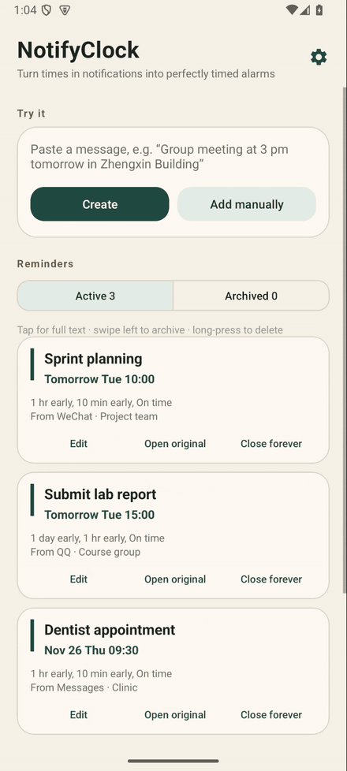
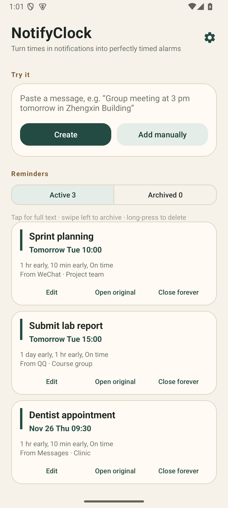
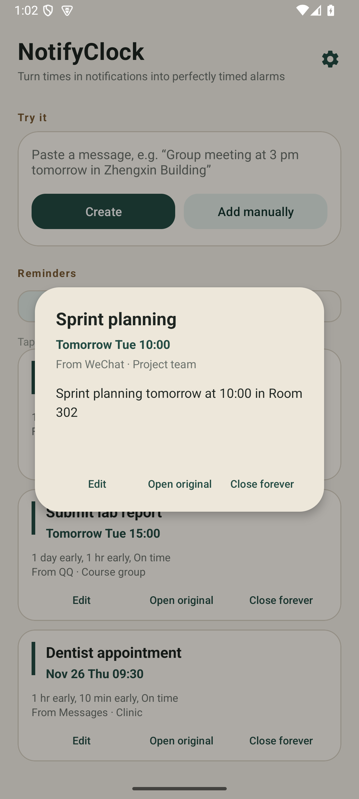
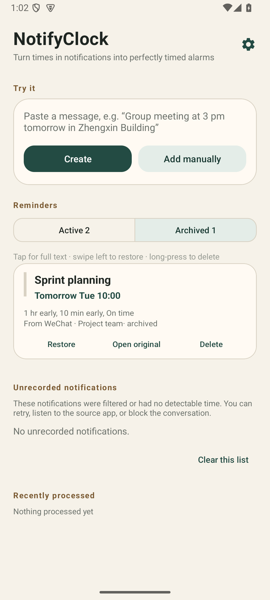

# NotifyClock (通知闹钟)

[简体中文](README.md) | **English**

NotifyClock turns dates and times inside chat notifications into reliable
Android alarms. It listens to notifications from WeChat, QQ, the HIT app,
and any other app you select, extracts the time with on-device rules (or an
optional OpenAI-compatible model), and schedules an exact alarm with a
full-screen confirmation screen.

[**Download the signed APK**](https://github.com/John20260411/NotifyClock/releases/latest)



## Why it exists

Chat messages often contain the only reminder you get:

> “Sprint planning tomorrow at 10:00 in Room 302.”

A normal notification is easy to miss, and copying it into a calendar app
takes time. NotifyClock watches the notification, pulls out the time, and
creates an alarm with your preferred lead times — including a full-screen
ring screen that works over the lock screen.

## Features

- **Notification → alarm.** Reads WeChat, QQ, HIT, and other selected apps.
- **Chinese and English.** Follow system language, 简体中文, or English.
  The app name follows the selected language (NotifyClock / 通知闹钟).
- **Multiple lead times.** For example 1 day, 1 hour, 30 minutes, and on
  time. Up to 9 per reminder.
- **Full-screen alarm.** Exact alarms, custom ringtone, vibration, snooze,
  and “close this time” vs “close permanently”.
- **Archive and search.** Swipe to archive, tap for the full text, long-press
  to delete, and open the original notification when it still exists.
- **Unrecorded notification inbox.** If a selected app sends a notification
  with no detectable time, it appears here with block / retry / ignore
  actions instead of being silently dropped.
- **Blocklist.** Block by conversation name, keyword, or package name.
- **Optional LLM parsing.** OpenAI-compatible endpoints (DeepSeek, Qwen,
  Kimi, Zhipu). Only messages that look like they contain a time are sent.
- **Local-first.** Rules parse most messages offline; diagnostics record
  metadata and text length/hash, not the full message body.

## Screenshots

| Main | Reminder detail | Swipe to archive |
| --- | --- | --- |
|  |  |  |

## Install

1. Download the signed APK from
   [Releases](https://github.com/John20260411/NotifyClock/releases/latest).
2. Allow installation from your browser/file manager when prompted.
3. Open **Settings → Permissions** and grant:
   - **Notification access** (required to read other apps’ notifications)
   - **Send notifications**
   - **Exact alarms**
   - **Full-screen intents**
   - **Ignore battery optimization**
4. Select the apps you want to monitor. WeChat, QQ, and TIM are selected by
   default.
5. On Xiaomi/Huawei/OPPO/vivo, also allow autostart and background activity,
   and lock the app in the recent-tasks screen.

## How parsing works

- **Rules first (default):** on-device parser handles Chinese and English
  expressions such as “明天下午3点”, “下周三上午10点半”, “11月5日 23:59”,
  “tomorrow at 3 pm”, “in 30 minutes”, “next month on the 5th”, and
  “by the end of the month”.
- **LLM first:** messages that look time-related go to the configured model.
- **Rules only:** fully offline.

If a message contains only a date, the app uses 09:00 unless it is a deadline
(“截止 / ddl / by”), in which case it uses 23:59, and marks the assumption in
the UI.

## Privacy

- Notification text is processed on the device by default.
- If you enable an LLM, only messages that look like they contain a time are
  sent to the endpoint you configure. The API key is stored in the app’s
  private SharedPreferences and is never uploaded to this repository.
- Diagnostics keep metadata (package, notification key hash, text length and
  hash, parse result) and do not store full chat content.
- The app does not require an account.

## Build

Requirements: JDK 17, Android SDK platform 35, Android Gradle Plugin 8.5.2.

```bash
./gradlew testDebugUnitTest assembleDebug
```

Release signing reads `RELEASE_STORE_FILE`, `RELEASE_STORE_PASSWORD`,
`RELEASE_KEY_ALIAS`, and `RELEASE_KEY_PASSWORD` from the environment. Never
commit the keystore or its passwords.

## Status and limitations

- Tested on a physical Android 16 device and an Android 15 emulator.
- Some OEMs aggressively kill background services; the permission screen
  lists the settings to change.
- If the system hides sensitive notification content, the body cannot be
  read; enable “show message details” in WeChat/QQ.
- Group summaries, ongoing notifications, and custom notification layouts
  vary by app and version; the unrecorded inbox shows what was filtered.

## License and commercial use

Source-available under the **PolyForm Noncommercial License 1.0.0**. Personal,
research, educational, charitable, and other noncommercial use is allowed.
Commercial use requires a separate written license.

- [LICENSE](LICENSE)
- [Commercial licensing](COMMERCIAL.md)
- [Contributing and CLA](CONTRIBUTING.md)

This is not an OSI open-source license. The copyright holder retains the
right to offer commercial licenses, including for community contributions
accepted under the [CLA](CLA.md).
